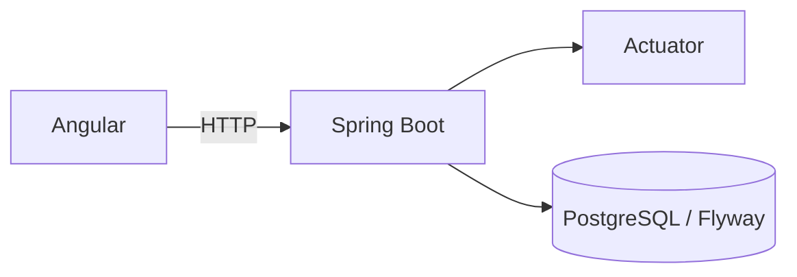

# AI Dev Office

Plataforma em construção para colaboração entre agentes de inteligência artificial no desenvolvimento de software, com revisão e aprovação humana.

O projeto é um ambiente de aprendizado profissional e portfólio para Full Stack Java, Angular e AI Engineer. A proposta é transformar demandas em requisitos, arquitetura, tarefas, implementação, testes e revisão, preservando evidências do trabalho realizado.

## Status atual

Fundação da Fase 1 criada. Backend mínimo, frontend com consulta real de saúde, migração inicial, Compose PostgreSQL, testes básicos, documentação e workflow de CI estão presentes. Consulte [a validação local](docs/validation.md) para distinguir o que foi executado das verificações pendentes.

Gestão de projetos e tarefas, integração com modelos, agentes, WebSocket, ferramentas e escritório virtual são funcionalidades planejadas. O escritório 2D deverá refletir eventos reais do backend.

Licença pendente por decisão do titular. A inclusão da MIT será avaliada posteriormente. A publicação pública ainda depende dessa definição e de autorização.

## Tecnologias

- Java 21 LTS, Spring Boot 3.5.16 e Maven Wrapper 3.9.11.
- Spring Web, Data JPA, Security, Validation, Actuator e Springdoc OpenAPI.
- PostgreSQL 17.12 e Flyway.
- Angular 21 LTS, TypeScript 5.9, standalone components, Signals, RxJS e Angular Material.
- JUnit 5, Mockito disponível no starter de testes, MockMvc, H2, Testcontainers e Vitest.
- Docker Compose e GitHub Actions configurados.

As versões foram verificadas em fontes oficiais e fixadas no POM e lockfile. Veja [compatibilidade e pendências](docs/versions.md). O uso de Spring AI ou LangChain4j está em avaliação para a Fase 3.

## Arquitetura

Monólito modular com frontend separado no mesmo repositório. A fundação implementa configuração de plataforma. Os módulos de projetos, tarefas, agentes, orquestração, ferramentas, eventos e IA serão introduzidos conforme os casos de uso.



Consulte [a arquitetura](docs/architecture.md), [os ADRs](docs/adr/) e [a especificação dos agentes](docs/agents.md).

## Estrutura

```text
ai-dev-office/
├── .github/                 # CI e templates de contribuição
├── backend/
│   ├── .mvn/wrapper/        # Maven fixado, sem instalação global
│   ├── src/main/java/dev/aidevoffice/
│   │   └── platform/       # Segurança e contrato OpenAPI
│   ├── src/main/resources/db/migration/
│   └── src/test/           # Spring/MockMvc e PostgreSQL Testcontainers
├── frontend/
│   ├── src/app/            # Página de saúde e testes
│   └── proxy.conf.json     # Encaminhamento local para o backend
├── infra/compose.yml       # PostgreSQL para desenvolvimento
├── docs/
│   ├── adr/
│   ├── learning/
│   └── superpowers/        # Design e plano desta entrega
├── .env.example
├── AGENTS.md
└── CONTRIBUTING.md
```

## Como executar localmente

Requisitos — JDK 21, Node 24 com npm, Docker Engine ou Docker Desktop com Compose v2 e Git. Maven e Angular CLI globais são dispensáveis. No notebook usado nesta entrega, Docker e npm global não estão disponíveis. Foram usadas cópias oficiais locais de npm e Maven no workspace pai para os builds. Veja [os detalhes](docs/validation.md).

### 1. Configuração e PostgreSQL

A partir da raiz do repositório, copie `.env.example` para `.env`.

```powershell
Copy-Item .env.example .env
```

O exemplo usa o banco `ai_dev_office`, usuário `office` e porta 5432. Forneça a senha no ambiente do terminal. Ela será herdada pelo Compose e pelo backend iniciado no mesmo terminal. O `.env` é usado pelo Compose e fica ignorado pelo Git. O backend lê variáveis de ambiente do processo.

```powershell
$env:POSTGRES_PASSWORD = Read-Host 'Senha do PostgreSQL local' -MaskInput
docker compose --env-file .env -f infra/compose.yml config --quiet
docker compose --env-file .env -f infra/compose.yml up -d --wait
```

`-MaskInput` exige PowerShell 7. Em Windows PowerShell 5.1, use o terminal PowerShell 7 ou forneça a variável por seu gerenciador de ambiente. No Bash, use `read -rs POSTGRES_PASSWORD` e `export POSTGRES_PASSWORD`. A variável do processo tem precedência sobre a entrada vazia do `.env`.

Se alterar banco, usuário ou porta no `.env`, configure também `POSTGRES_USER` e `SPRING_DATASOURCE_URL` no ambiente do terminal do backend. Por exemplo, `$env:POSTGRES_USER = 'outro_usuario'` e `$env:SPRING_DATASOURCE_URL = 'jdbc:postgresql://localhost:5433/outro_banco'`.

O volume preserva o banco ao parar os serviços. Mudanças de usuário, banco ou senha no `.env` não alteram automaticamente um volume já inicializado. Nesse caso, ajuste as credenciais do banco existente com procedimento próprio.

### 2. Backend

No mesmo terminal em que definiu a senha, a partir da raiz.

```powershell
cd backend
.\mvnw.cmd spring-boot:run
```

Em Linux/macOS, use `sh mvnw spring-boot:run`. Na primeira execução, o Wrapper baixa a distribuição Maven fixada. Flyway cria o schema `office`, destinado aos futuros módulos. Se iniciar o backend em outro terminal, defina `POSTGRES_PASSWORD` com o mesmo valor nesse terminal.

- Saúde geral em `http://localhost:8080/actuator/health`.
- Readiness com banco em `http://localhost:8080/actuator/health/readiness`.
- Liveness em `http://localhost:8080/actuator/health/liveness`.
- OpenAPI em `http://localhost:8080/v3/api-docs` e interface em `http://localhost:8080/swagger-ui.html`.

Outras rotas são negadas pela configuração de segurança da fundação. Ainda não há login de usuário ou endpoints de gestão. Os logs de produção usam JSON ECS.

### 3. Frontend

Em outro terminal, a partir da raiz.

```powershell
cd frontend
npm ci
npm start
```

Acesse `http://localhost:4200`. A página consulta o readiness real e oferece nova tentativa. O proxy aponta para `127.0.0.1:8080`. Se mudar `SERVER_PORT`, ajuste `frontend/proxy.conf.json`. O build estático de produção exige configuração de proxy no servidor de hospedagem, a ser definida em fase futura.

### 4. Testes e builds

```powershell
cd backend
.\mvnw.cmd verify
cd ../frontend
npm test -- --watch=false
npm run build
npm audit --omit=dev
```

O JAR fica em `backend/target/`. O frontend compilado fica em `frontend/dist/ai-dev-office/browser/`. Os testes rápidos Java usam H2. O teste adicional PostgreSQL usa Docker e é explicitamente ignorado se o daemon não estiver disponível. No CI, o workflow verifica que esse teste foi executado.

Para encerrar somente o PostgreSQL de desenvolvimento, use `docker compose --env-file .env -f infra/compose.yml stop` a partir da raiz.

## Roadmap

1. Fundação de repositório, aplicações, PostgreSQL, saúde e testes.
2. Gestão de projetos, tarefas, estados, persistência e dashboard.
3. Primeiro agente, SDK de LLM, orquestração, histórico e aprovação humana.
4. Equipe especializada com passagem de contexto e revisão.
5. Escritório Phaser e eventos WebSocket reais.
6. Execução isolada, observabilidade, segurança, CI/CD e demonstração.

Execução de código gerado exige antecipar a entrega de isolamento da Fase 6. A configuração Compose atual fornece apenas o banco local. [Backlog completo com critérios, dependências e testes](docs/roadmap.md).

## Objetivos de aprendizado

Aplicar arquitetura modular, injeção de dependência, transações, migrações, testes de contrato, segurança, reatividade e orquestração auditável. Relacionar Spring com a experiência em Apex e Angular com LWC quando ajudar na compreensão. [Conceitos e exercícios da fundação](docs/learning/foundation.md).

## Contribuição

Leia [CONTRIBUTING.md](CONTRIBUTING.md). Antes de iniciar outra fase, escolha uma Issue do roadmap e defina seus critérios de aceite. Os rascunhos de Issues permanecem locais até autorização de publicação no GitHub.
