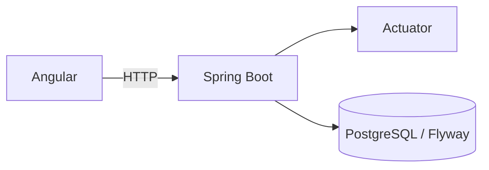

# AI Dev Office

Plataforma em construção para colaboração entre agentes de inteligência artificial no desenvolvimento de software, com revisão e aprovação humana.

O projeto é um ambiente de aprendizado profissional e portfólio para Full Stack Java, Angular e AI Engineer. A proposta é transformar demandas em requisitos, arquitetura, tarefas, implementação, testes e revisão, preservando evidências do trabalho realizado.

## Status atual

Fases 1 a 5 implementadas no escopo descrito no roadmap: gestão, analista local, equipe multiagente, aprovação humana e escritório 2D com eventos reais. A equipe analisa demandas e cria tarefas após aprovação; ainda não escreve nem executa código. APIs exigem credenciais locais. Consulte [validação das Fases 4 e 5](docs/validation-phases-four-five.md) e a [validação local](docs/validation.md).

Execução de código isolada, política de ferramentas e observabilidade de produção permanecem planejadas para a Fase 6. O escritório 2D exibe eventos reais persistidos pelo backend.

Licença pendente por decisão do titular. A inclusão da MIT será avaliada posteriormente. A publicação pública ainda depende dessa definição e de autorização.

## Tecnologias

- Java 21 LTS, Spring Boot 3.5.16 e Maven Wrapper 3.9.11.
- Spring Web, Data JPA, Security, Validation, Actuator e Springdoc OpenAPI.
- PostgreSQL 17.12 e Flyway.
- Angular 21 LTS, TypeScript 5.9, standalone components, Signals, RxJS e Angular Material.
- JUnit 5, Mockito disponível no starter de testes, MockMvc, H2, Testcontainers e Vitest.
- Docker Compose e GitHub Actions configurados.

As versões foram verificadas em fontes oficiais e fixadas no POM e lockfile. Veja [compatibilidade e pendências](docs/versions.md). A integração de IA usa Spring AI com Ollama local.

## Arquitetura

Monólito modular com frontend separado no mesmo repositório. Os módulos implementados cobrem plataforma, projetos, tarefas, análise local, orquestração sequencial da equipe e eventos do escritório. Execução isolada de ferramentas permanece planejada.



Consulte [a arquitetura](docs/architecture.md), [os ADRs](docs/adr/) e [a especificação dos agentes](docs/agents.md).

## Estrutura

```text
ai-dev-office/
├── .github/                 # CI e templates de contribuição
├── backend/
│   ├── .mvn/wrapper/        # Maven fixado, sem instalação global
│   ├── src/main/java/dev/aidevoffice/
│   │   └── platform/       # Segurança e contrato OpenAPI
│   ├── src/main/resources/db/migration/
│   └── src/test/           # Spring/MockMvc e PostgreSQL Testcontainers
├── frontend/
│   ├── src/app/            # Página de saúde e testes
│   └── proxy.conf.json     # Encaminhamento local para o backend
├── infra/compose.yml       # PostgreSQL para desenvolvimento
├── docs/
│   ├── adr/
│   ├── learning/
│   └── superpowers/        # Design e plano desta entrega
├── .env.example
├── AGENTS.md
└── CONTRIBUTING.md
```

## Como executar localmente

Requisitos — JDK 21, Node 24 com npm, Docker Engine ou Docker Desktop com Compose v2 e Git. Maven e Angular CLI globais são dispensáveis. No notebook usado nesta entrega, Docker e npm global não estão disponíveis. Foram usadas cópias oficiais locais de npm e Maven no workspace pai para os builds. Veja [os detalhes](docs/validation.md).

### 1. Configuração e PostgreSQL

A partir da raiz do repositório, copie `.env.example` para `.env`.

```powershell
Copy-Item .env.example .env
```

O exemplo usa o banco `ai_dev_office`, usuário `office` e porta 5432. Forneça a senha no ambiente do terminal. Ela será herdada pelo Compose e pelo backend iniciado no mesmo terminal. O `.env` é usado pelo Compose e fica ignorado pelo Git. O backend lê variáveis de ambiente do processo.

No mesmo terminal, configure também a credencial da aplicação:

```powershell
$env:APP_USERNAME = 'office'
$env:APP_PASSWORD = Read-Host 'Senha da aplicação' -MaskInput
```

Use uma senha diferente da senha do PostgreSQL. O login é de usuário único para desenvolvimento local; não há contas ou isolamento por pessoa nesta fase.

```powershell
$env:POSTGRES_PASSWORD = Read-Host 'Senha do PostgreSQL local' -MaskInput
docker compose --env-file .env -f infra/compose.yml config --quiet
docker compose --env-file .env -f infra/compose.yml up -d --wait
```

`-MaskInput` exige PowerShell 7. Em Windows PowerShell 5.1, use o terminal PowerShell 7 ou forneça a variável por seu gerenciador de ambiente. No Bash, use `read -rs POSTGRES_PASSWORD` e `export POSTGRES_PASSWORD`. A variável do processo tem precedência sobre a entrada vazia do `.env`.

Se alterar banco, usuário ou porta no `.env`, configure também `POSTGRES_USER` e `SPRING_DATASOURCE_URL` no ambiente do terminal do backend. Por exemplo, `$env:POSTGRES_USER = 'outro_usuario'` e `$env:SPRING_DATASOURCE_URL = 'jdbc:postgresql://localhost:5433/outro_banco'`.

O volume preserva o banco ao parar os serviços. Mudanças de usuário, banco ou senha no `.env` não alteram automaticamente um volume já inicializado. Nesse caso, ajuste as credenciais do banco existente com procedimento próprio.

### 2. Backend

No mesmo terminal em que definiu a senha, a partir da raiz.

```powershell
cd backend
.\mvnw.cmd spring-boot:run
```

Em Linux/macOS, use `sh mvnw spring-boot:run`. Na primeira execução, o Wrapper baixa a distribuição Maven fixada. Flyway cria o schema `office`, destinado aos futuros módulos. Se iniciar o backend em outro terminal, defina `POSTGRES_PASSWORD` com o mesmo valor nesse terminal.

- Saúde geral em `http://localhost:8080/actuator/health`.
- Readiness com banco em `http://localhost:8080/actuator/health/readiness`.
- Liveness em `http://localhost:8080/actuator/health/liveness`.
- OpenAPI em `http://localhost:8080/v3/api-docs` e interface em `http://localhost:8080/swagger-ui.html`.

### Analista local (Fase 3)

Instale o Ollama separadamente e baixe o modelo uma vez com `ollama pull qwen2.5:3b`. O projeto usa por padrão `http://localhost:11434`; configure `OLLAMA_BASE_URL` ou `OLLAMA_MODEL` no ambiente do backend para alterar. O startup não instala Ollama nem baixa modelos. Com o serviço local ativo, abra um projeto e envie uma demanda no painel “Analista local”. A saída é apenas um rascunho; aprove o hash exibido para criar suas tarefas. Veja [guia da Fase 3](docs/learning/phase-three.md) e [ADR 0005](docs/adr/0005-local-ai-provider.md).

### Equipe e escritório 2D (Fases 4 e 5)

No painel “Equipe multiagente e escritório”, envie uma demanda para seis papéis Ollama sequenciais. Os passos aparecem na timeline e na sala 2D; ao final, revise o plano agregado e aprove pelo hash para criar tarefas. WebSocket transmite eventos reais e o histórico REST recupera a conexão. Não há execução de código ou ferramentas. Detalhes: [guia Fases 4/5](docs/learning/phases-four-five.md), [ADR 0006](docs/adr/0006-sequential-agent-team.md), [ADR 0007](docs/adr/0007-office-events-and-canvas.md).

Rotas de gestão e OpenAPI exigem HTTP Basic. Configure `APP_USERNAME` e `APP_PASSWORD` no ambiente do terminal que inicia o backend; o exemplo usa `office` como usuário. A tela Angular solicita essas credenciais e as mantém apenas em memória. Health continua público. O backend escuta em loopback por padrão; uma exposição de rede exige HTTPS e revisão da política de usuários. Os logs de produção usam JSON ECS.

### 3. Frontend

Em outro terminal, a partir da raiz.

```powershell
cd frontend
npm ci
npm start
```

Acesse `http://localhost:4200`. A página consulta o readiness real e oferece nova tentativa. O proxy aponta para `127.0.0.1:8080`. Se mudar `SERVER_PORT`, ajuste `frontend/proxy.conf.json`. O build estático de produção exige configuração de proxy no servidor de hospedagem, a ser definida em fase futura.

### 4. Testes e builds

```powershell
cd backend
.\mvnw.cmd verify
cd ../frontend
npm test -- --watch=false
npm run build
npm audit --omit=dev
```

O JAR fica em `backend/target/`. O frontend compilado fica em `frontend/dist/ai-dev-office/browser/`. Os testes rápidos Java usam H2. O teste adicional PostgreSQL usa Docker e é explicitamente ignorado se o daemon não estiver disponível. No CI, o workflow verifica que esse teste foi executado.

Para encerrar somente o PostgreSQL de desenvolvimento, use `docker compose --env-file .env -f infra/compose.yml stop` a partir da raiz.

## Roadmap

1. Fundação de repositório, aplicações, PostgreSQL, saúde e testes.
2. Gestão de projetos, tarefas, estados, persistência e dashboard.
3. Primeiro agente, SDK de LLM, orquestração, histórico e aprovação humana.
4. Equipe especializada com passagem de contexto e revisão.
5. Escritório Phaser e eventos WebSocket reais.
6. Execução isolada, observabilidade, segurança, CI/CD e demonstração.

Execução de código gerado exige antecipar a entrega de isolamento da Fase 6. A configuração Compose atual fornece apenas o banco local. [Backlog completo com critérios, dependências e testes](docs/roadmap.md).

## Objetivos de aprendizado

Aplicar arquitetura modular, injeção de dependência, transações, migrações, testes de contrato, segurança, reatividade e orquestração auditável. Relacionar Spring com a experiência em Apex e Angular com LWC quando ajudar na compreensão. Leia [os conceitos da fundação](docs/learning/foundation.md) e [os conceitos da Fase 2](docs/learning/phase-two.md).

## Contribuição

Leia [CONTRIBUTING.md](CONTRIBUTING.md). Antes de iniciar outra fase, escolha uma Issue do roadmap e defina seus critérios de aceite. Os rascunhos de Issues permanecem locais até autorização de publicação no GitHub.
