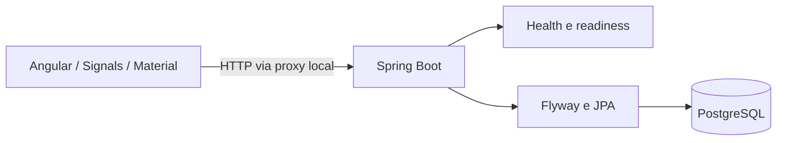

# Arquitetura

## Fundação implementada

Monorepositório com um backend Spring Boot, frontend Angular standalone e banco PostgreSQL. A Fase 1 contém configuração, migração inicial, observabilidade de saúde e uma página que consulta o backend. Os módulos de negócio abaixo são contratos de evolução. Ainda não possuem casos de uso.

## Limites dos módulos planejados

| Pacote futuro | Responsabilidade | Dependências permitidas |
| --- | --- | --- |
| projects | Projetos e metadados | Nenhum domínio externo |
| tasks | Backlog, critérios de aceite e estados | API pública de projects |
| agents | Cadastro, papéis e configuração | Nenhuma implementação de LLM |
| orchestration | Execuções, dependências e transições | APIs de tasks, agents, ai, tools e events |
| tools | Política, aprovação e execução de ferramentas | Portas próprias para ambiente isolado |
| events | Eventos persistidos e monitoramento | Contratos versionados |
| ai | Adaptadores dos modelos e contexto | SDK escolhido na Fase 3 |
| platform | Configuração transversal e saúde | Infraestrutura Spring |

Começar com pacotes por negócio, dentro deles separar API, aplicação, domínio e infraestrutura conforme os primeiros casos de uso surgirem. Entidades JPA não atravessam contratos HTTP. DTOs e Bean Validation serão adicionados junto dos endpoints de gestão. Repository será a interface Spring Data para persistência. Strategy só será necessária quando existirem estratégias distintas, como provedores de modelos. Evitar classes base, fábricas e interfaces sem consumidores reais.

## Saúde e segurança

`/actuator/health` informa estado geral. `/actuator/health/liveness` informa vida do processo. `/actuator/health/readiness` também verifica o banco. Ausência do banco pode impedir a inicialização porque Flyway valida a migração no startup. Respostas públicas omitem detalhes internos. OpenAPI e Swagger UI estão liberados nesta fundação local. Demais rotas são negadas. Autenticação e autorização do usuário pertencem à fase de gestão e exigem decisão própria antes de disponibilizar APIs reais.

Logs usam JSON ECS. Não registrar prompts completos, credenciais nem conteúdo de arquivos por padrão. O Compose publica PostgreSQL somente em loopback. Segredos são fornecidos por ambiente, `.env` fica ignorado pelo Git. O backend recebe variáveis do processo. O Compose também lê `.env`, com precedência das variáveis do processo. O backend não interpreta o arquivo `.env` como propriedades Java.

## Evolução multiagente

Uma demanda gera tarefas e execuções persistidas. Cada tentativa terá identificador próprio, versão de contexto, timestamps, modelo, consumo, ferramentas, decisões e artefatos. Transições precisam validar o estado anterior e tolerar reentrega de eventos. Cancelamento, timeout e falha parcial devem ser estados auditáveis. Persistir eventos com a mudança de estado, usando outbox quando o envio assíncrono for implementado.

O backend será a fonte de verdade. WebSocket deverá retransmitir eventos reais. O Phaser consumirá esses mesmos eventos na Fase 5. Reconexão exigirá cursor e recuperação de histórico. Nenhuma animação deve inventar progresso.

Antes de executar código, implementar executor isolado com limites de CPU, memória, tempo, arquivos e rede. Aprovação humana deve ser vinculada à operação exata e ao conteúdo revisado, com expiração e invalidação quando mudar. Somente o serviço de execução poderá liberar credenciais mínimas. Agentes não recebem acesso livre ao host. Docker Compose desta fase fornece apenas PostgreSQL e não constitui uma sandbox de execução de agentes.
