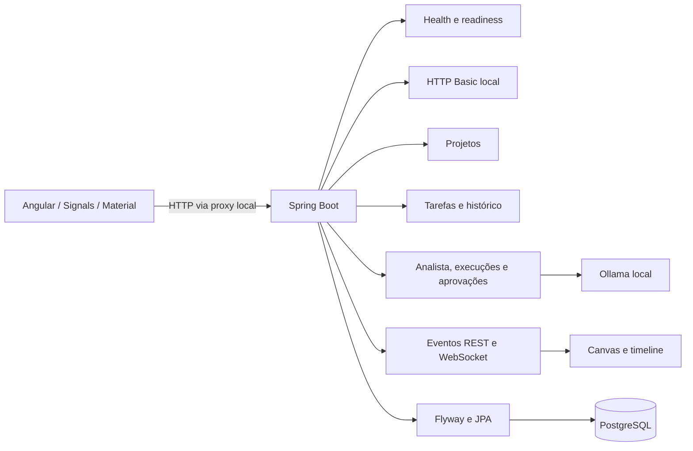

# Arquitetura

## Visão geral

Monorepositório com backend Spring Boot, frontend Angular standalone e PostgreSQL. Inclui gestão, análise local, equipe sequencial, aprovação humana, eventos em tempo real e propostas de execução isolada sob revisão.

## Gestão implementada

`projects` expõe criação e listagem paginada, com limites e ordenação estável. `tasks` expõe criação e consulta por projeto, alteração de estado com controle de versão, dependências do mesmo projeto e histórico de estados. Tarefas começam em `TODO`; só passam para `IN_PROGRESS` quando suas dependências estão `DONE`. Transições inválidas, dependências cíclicas e versões antigas retornam conflito. A validação do schema Hibernate é baseada nas migrações Flyway.

O acesso usa o usuário único configurado no ambiente. Veja [ADR 0004](adr/0004-phase-two-access.md). Não há isolamento por usuário, autenticação federada ou endpoints de exclusão nesta fase.

Rotas de gestão (todas exigem HTTP Basic):

- `POST /api/projects` e `GET /api/projects?page=0&size=20`.
- `POST /api/projects/{projectId}/tasks` e `GET /api/projects/{projectId}/tasks`.
- `PUT /api/tasks/{taskId}/status`, com `status` e `version` no corpo.
- `PUT /api/tasks/{taskId}/dependencies`, com `dependencyIds` e `version` no corpo.
- `GET /api/tasks/{taskId}/history`.

## Módulos implementados e limites

O módulo `agents` persiste execuções, tentativas, eventos e decisões. A geração usa uma porta (`AnalysisGenerator`) com adaptador Spring AI/Ollama. A fila local tem concorrência 1; a interface consulta o estado real e apresenta rascunhos para aprovação. Não há execução de ferramentas ou código. Veja o [guia da Fase 3](learning/phase-three.md).

O fluxo `team_runs` encadeia seis papéis locais, com `team_steps` e artefatos por tentativa. QA produz uma revisão textual e o revisor fecha a recomendação; a pessoa usuária decide. `project_events` guarda o cursor transacional usado por REST e WebSocket. O endpoint WebSocket só aceita tickets de projeto, de uso único e curtos. O Canvas ilustra os estados; a timeline HTML mantém alternativa acessível. Veja [Fases 4 e 5](learning/phases-four-five.md).

| Pacote | Responsabilidade | Dependências permitidas |
| --- | --- | --- |
| projects | Projetos e metadados | Nenhum domínio externo |
| tasks | Backlog, critérios de aceite e estados | API pública de projects |
| agents | Analista local, aprovações e execução sequencial de seis papéis | APIs de tasks e porta de IA |
| orchestration | Passagem de contexto, tentativas, artefatos e aprovação do plano | APIs de tasks, agents, ai e events |
| tools | Aprovação, fila, execução efêmera e histórico de ferramentas JavaScript | PostgreSQL e daemon Docker dedicado |
| events | Eventos persistidos, histórico REST e entrega WebSocket | Contratos versionados |
| ai | Adaptador Spring AI/Ollama; outros provedores futuros | Porta AnalysisGenerator |
| platform | Configuração transversal e saúde | Infraestrutura Spring |

Começar com pacotes por negócio, dentro deles separar API, aplicação, domínio e infraestrutura conforme os primeiros casos de uso surgirem. Entidades JPA não atravessam contratos HTTP. DTOs e Bean Validation são usados nas APIs de gestão. Repository é a interface Spring Data para persistência. Strategy só será necessária quando existirem estratégias distintas, como provedores de modelos. Evitar classes base, fábricas e interfaces sem consumidores reais.

## Saúde e segurança

`/actuator/health` informa estado geral. `/actuator/health/liveness` informa vida do processo. `/actuator/health/readiness` também verifica o banco. Ausência do banco pode impedir a inicialização porque Flyway valida a migração no startup. Respostas públicas omitem detalhes internos. Health permanece público; APIs de gestão e OpenAPI exigem a credencial definida por ambiente, conforme o [ADR 0004](adr/0004-phase-two-access.md). O backend escuta em loopback por padrão.

Logs usam JSON ECS. Não registrar prompts completos, credenciais nem conteúdo de arquivos por padrão. O Compose publica PostgreSQL somente em loopback. Segredos são fornecidos por ambiente, `.env` fica ignorado pelo Git. O backend recebe variáveis do processo. O Compose também lê `.env`, com precedência das variáveis do processo. O backend não interpreta o arquivo `.env` como propriedades Java.

## Fluxo multiagente e trabalho futuro

Uma demanda gera uma execução persistida e passa pelos seis papéis locais. O contexto é acumulado entre passos e os artefatos, tentativas e falhas ficam registrados. Saídas inválidas recebem uma repetição limitada. Após o revisor, o plano aguarda aprovação humana vinculada ao hash; aprovar cria tarefas em `TODO`.

O backend é a fonte de verdade. Eventos persistidos são entregues por REST e WebSocket autenticado por ticket temporário de uso único. O canvas e a timeline representam os mesmos estados do backend; a recuperação usa cursor e histórico.

O painel de ferramentas usa uma aprovação independente vinculada ao código, à ferramenta e à imagem. O worker passa código por stdin a um contêiner sem montagens do host e registra o resultado por projeto. O Compose fornece PostgreSQL. O daemon dedicado do executor tem configuração própria. [ADR 0008](adr/0008-isolated-tool-execution.md).
